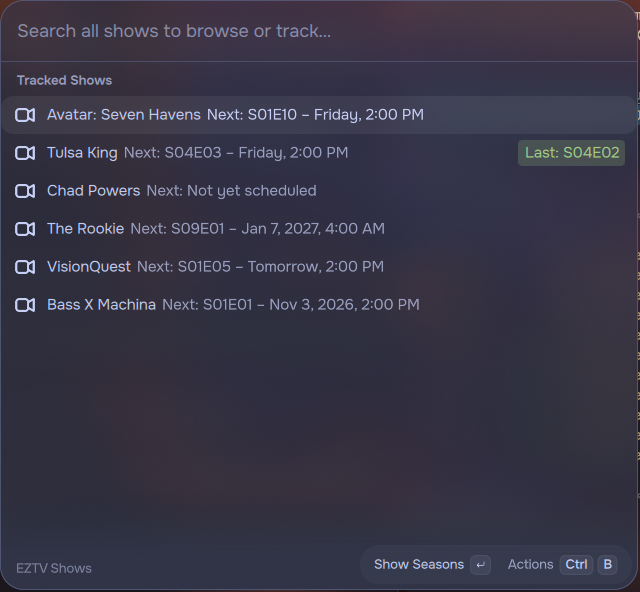
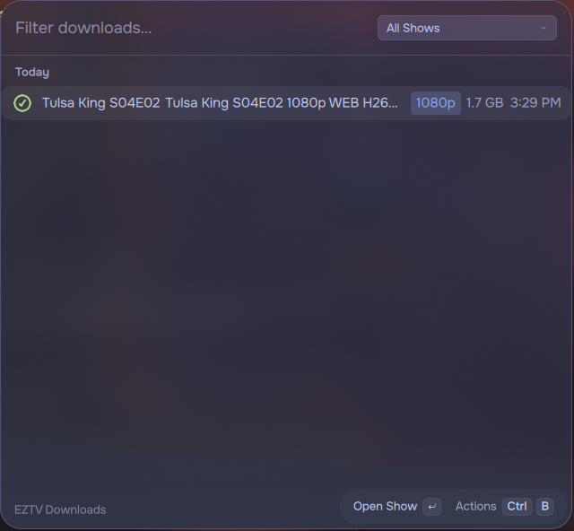

# EZTV Tracker for Pond

A [Vicinae](https://vicinae.com) launcher extension (Pond's launcher) for tracking shows on
[EZTV](https://eztvx.to): episodes grouped by season, releases grouped by quality with the best
one picked automatically, each show's next air date via [TVMaze](https://www.tvmaze.com), and a
history of everything you've sent to your torrent client.

A port of [oma-eztv](https://github.com/nursahketene/oma-eztv), the Omarchy bar plugin, with
download tracking added.

| EZTV Shows | EZTV Downloads |
|---|---|
|  |  |

## Commands

**EZTV Shows**

- Lists your tracked shows with their next air date, and the last episode you downloaded.
- Typing searches TVMaze's whole catalog, so you can browse or track any show.
- Enter opens a show's seasons (with how many episodes of each you've downloaded), then its
  episodes. Already-downloaded episodes get a green check showing the quality and when.
- On an episode, Enter sends the best release to your torrent client. `Ctrl+B` shows the other
  qualities, *Mark as Downloaded / Not Downloaded* (`Ctrl+M`), and *Copy Magnet Link*.
- *Track Show* / *Stop Tracking Show* live in every show's `Ctrl+B` menu.

**EZTV Downloads**

Everything you've downloaded or marked, newest first, grouped by day, with a filter by show.
You can download an episode again, jump to its show, or remove entries.

## Files

| File | Contents |
|---|---|
| `~/.config/pond-eztv/shows.json` | Tracked shows: `[{ "name": "Severance", "imdbId": "11280740" }]`. Same format as oma-eztv's `shows.json`, so an old list can be copied over as-is. |
| `~/.local/share/pond-eztv/downloads.json` | Download history. Each click is one entry, so downloading an episode in two qualities records both. |

## Development

```bash
npm install
npm run dev      # live-reloading dev session; Vicinae must be running
npm run build    # production build, installs it into Vicinae
```

## How it works

- **Episodes, qualities and magnet links** come from EZTV's `get-torrents` API, grouped by the
  `season`/`episode` fields it provides; quality is parsed from the release title. At most 500
  releases (5 pages) are fetched per show.
- **Next air dates, descriptions and search** come from TVMaze's public API.
- **Downloading** opens the magnet link with whatever handles `magnet:` links (`xdg-open`
  semantics), normally your torrent client. Nothing is downloaded by the extension itself.

**EZTV's domain** has moved before (`.ag` → `.io` → `.re` → `eztvx.to`). If every fetch starts
failing at once, update `EZTV_BASE` in `src/lib/api.ts`.

**A note on legality:** EZTV links to copyrighted content without license from most rights
holders in most jurisdictions. What you do with the magnet links is on you; check your local laws.

## License

MIT
